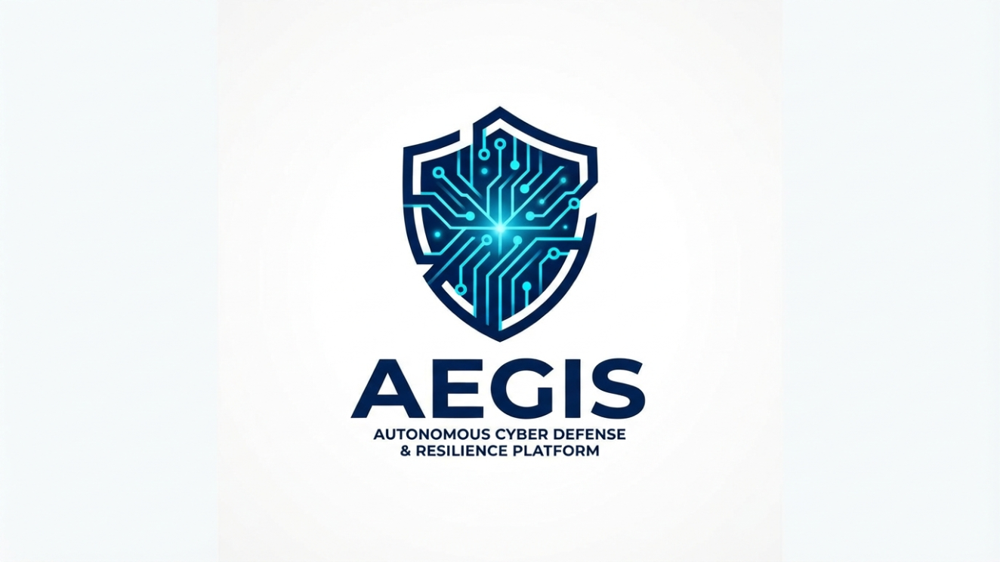

<p align="center">
  
</p>

# AEGIS: Autonomous AI Defense Platform (Monitor, Detect, Defend)

> Project 27SUTDP230 · Faculty of Engineering Technology, Computer Science Technology
> Elsewedy University of Technology, Polytechnic of Egypt · Academic year 2026-2027

AEGIS is a closed-loop defense platform for Windows Active Directory environments. It monitors identity and endpoint telemetry, detects attacks with rules, machine learning and a local language model, and responds through human-approved playbooks. Everything is built and tested in an isolated Hyper-V cyber range.

**Safety rule:** the AI model recommends and never executes. Log content is treated as untrusted input, targets come only from the original alert fields, and Domain Controllers, admin accounts and break-glass accounts are never actioned automatically.

## Status

Early development. Items marked *planned* are not yet in the repository.

| Stage | State |
| --- | --- |
| Proposal and design | Done |
| Lab, AD and Zero-Trust GPOs | In progress |
| Wazuh, Sysmon, event forwarding | Planned |
| AI triage and anomaly detection | Planned |
| Approval workflow and playbooks | Planned |
| Cyber range evaluation | Planned |

## Architecture

```
MONITOR                    DETECT                      DEFEND
Sysmon + audit policy  ->  Wazuh rules             ->  Policy gate (code)
Windows Event Forwarding   Isolation Forest (logons)   Auto: block IP, isolate workstation
Wazuh agents + server      Local LLM triage (Ollama)   Approval: servers, DCs, accounts
Zero-Trust GPOs, MFA       Threat-intel matching       Audit log + rollback, kill switch
Microsegmented firewalls   JSON-schema output check

        Agent-vs-Agent Cyber Range (isolated Hyper-V)
        Red Team AI attacks, Blue Team AI defends, results retrain models
```

## Modules

1. **Autonomous AI SOC**: telemetry ingestion, ML anomaly detection, LLM alert triage mapped to MITRE ATT&CK.
2. **Zero-Trust Access Platform**: identity, device, behavior checks, least privilege, microsegmentation.
3. **Threat-Intel-to-Auto-Response**: OSINT/STIX matching and tiered playbooks with human approval.
4. **Agent-vs-Agent Cyber Range**: repeatable attack scenarios and MTTD, MTTR and coverage metrics.

## Detected techniques (MITRE ATT&CK)

| Threat | ID |
| --- | --- |
| Kerberoasting | T1558.003 |
| AS-REP Roasting | T1558.004 |
| DCSync | T1003.006 |
| LSASS credential dumping | T1003.001 |
| Pass-the-Hash | T1550.002 |
| WMI / PsExec-style remote execution | T1047, T1569.002 |
| Log clearing | T1070.001 |
| Inhibit recovery | T1490 |

Verify IDs against https://attack.mitre.org before relying on them.

## Repository layout (planned)

```
aegis/
  docs/              proposal, architecture, test plan, results
  lab/               Hyper-V and AD build scripts
  gpo/               audit policy, Zero-Trust, firewall GPO scripts
  sysmon/            Sysmon configuration and deployment script
  wef/               Windows Event Forwarding subscription
  wazuh/             custom rules, decoders, integrations
  triage/            LLM triage script, prompt, decision schema
  ml/                Isolation Forest feature extraction and training
  response/          policy gate, playbooks, approval tool
  range/             Atomic Red Team scenarios, metrics scripts
  tests/             prompt-injection and safeguard tests
```

## Quick start (lab only)

Prerequisites: Hyper-V host, Windows Server 2022 evaluation ISO, Ubuntu for Wazuh, PowerShell 7.2+, Ollama.

1. Build the isolated Hyper-V network and take clean checkpoints.
2. Create the AD forest (`corp.local`), OUs and groups, then apply the audit, Sysmon and WEF GPOs on a pilot OU.
3. Install the Wazuh server and agents, and confirm events reach the dashboard.
4. Start the triage worker in **AlertOnly** mode. Move to **Approval** only after analysts have compared its output with their own decisions.
5. Run approved Atomic Red Team tests and record what each layer detects.

Never run attack simulations outside the isolated lab.

## Evaluation metrics

MTTD, MTTR, ATT&CK coverage, precision/recall/F1, false-alarm rate, alert analysis time, and explanation quality, compared against a Wazuh-rules-only baseline.

## Team

| Member | Role |
| --- | --- |
| Kareem Ahmed Gamal | Team leader, systems architecture integrator |
| Yousif Samir Darwish | Threat intelligence specialist |
| Ammar Yasser Abdullah | Automated response and playbook engineer |
| Abdelrahman Mohamed | Virtualization and cyber range specialist |
| Ali Taha Abbass | Cyber range AI agent engineer |
| Mazen Ayman Mahmoud | Zero-Trust engine developer |
| Andrew Farah Awadalla | Compliance, audit and security testing specialist |

Supervisors: Dr. Yassin Hassan, Dr. Mohamed Nabil Hassan.

## Responsible use

This project is for education and defensive research. All simulations run on systems the team controls inside an isolated lab. Do not use any content here against systems you do not own or have written permission to test.

## License

To be decided by the team (MIT or Apache-2.0 are common choices for open-source student projects).
